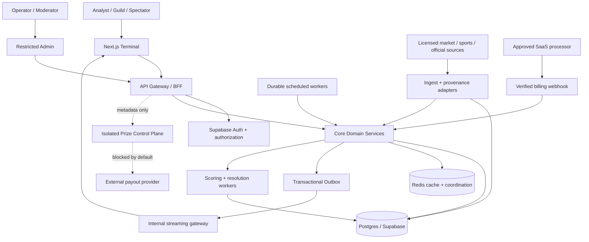
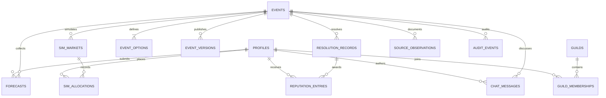
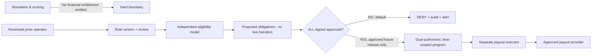

# FigSuite™ — Technical Architecture v1.1

**Status:** Implementation proposal / simulation-first / prize service default-off  
**Date:** 2026-11-03  
**Companion documents:** `01-PRD-v1.1.md`, `03-GITHUB-ROADMAP-v1.1.md`  
**Key constraints:** No cash or valuable consideration flows through simulated contracts; no prize egress possible by default; all user and market claims verifiable against authoritative server state.

## 1. System context and trust boundaries



**Four major boundaries**:
1. **Browser / server**: all mutations validated server-side; browser receives no DB service keys.
2. **External feed / trusted resolution**: external observations are untrusted input until normalized, timestamped, deduplicated, and reviewed against source rules.
3. **Simulation / economic value**: virtual ledgers cannot write to billing, prize, bank, or gift-card records and contain no conversion function to fiat.
4. **Core / prize execution**: even a compromised Core worker cannot transmit a live reward; the separate payout environment lacks operational credentials and network routes before formal activation.

## 2. Monorepo design and deployment topology

```text
figsuite/
  apps/
    terminal/                   # Next.js App Router BFF and user UI
    operator/                   # Separate operator portal, admin MFA
  packages/
    contracts/                  # zod/API types, events, error codes
    authz/                      # RBAC, entitlement, ownership policies
    db/                         # migrations, RLS, read models, outbox
    event-catalog/              # event schema/version/state machine
    forecasting/                # official probability forecasts
    simulation/                 # LMSR, virtual cost, position ledger
    scoring/                    # Brier, baselines, skill, reputation
    guilds/                     # aggregation, membership snapshots
    conversations/              # Gas, moderation, abuse controls
    vertical-finance/           # market adapter + calendar
    vertical-sports/            # future adapter
    vertical-events/            # future adapter
    billing/                    # approved SaaS-only interface
    prize-contracts/            # TypeScript interfaces ONLY in beta
    telemetry/                  # trace/audit schemas
    design-system/              # shared components/tokens
  services/
    feeds/                      # isolated licensed-data ingestion
    realtime/                   # broadcaster from internal outbox
    resolution/                 # durable settlement and review
    prize-control/              # separate deployment, disabled
  supabase/migrations/
  tests/{unit,integration,property,concurrency,security,e2e}/
  .github/{workflows,ISSUE_TEMPLATE}/
  docs/{prd,architecture,runbooks,decisions}/
```

**Runtime stack:** Next.js App Router + TypeScript + Tailwind + accessible icon library; Supabase PostgreSQL/Auth/RLS; Redis for cache, throttle, dedupe hints (not source of transaction truth); durable job orchestrator such as Inngest; separate service for WebSocket or managed realtime; an approved market feed (e.g. Massive) with a licensed use case; Sentry/OpenTelemetry-equivalent observability; Vercel or equivalent for front-end deployment; independent backend workers where required. Version numbers and vendor contracts are pinned and reviewed at bootstrap rather than inherited blindly from an older PRD.

**Massive limitation:** a financial market-data subscription is a source of prices/transactions, not a transport for FigSuite community chat or its own simulated allocation book. Expose an **internal simulation depth/flow** chart only; do not label it exchange Level 2 depth without a separately licensed Level 2 data provider.

**Environments:** `local → preview → staging → production`; independent Supabase projects/databases for staging and production; signed migration approvals; secrets per environment. Prize service default-off in **all**. Preview never accesses production feed entitlements, payment secrets, or user PII. Production database never cloned into preview without anonymization.

## 3. Domain model



**Tables (minimum definitions):**

| Table | Key fields | Constraint/index emphasis |
|---|---|---|
| `profiles` | `id uuid PK`, `handle`, `age_attested_at`, `region`, `status` | Unique case-folded handle; pseudonymous public profile |
| `events` | `id`, `vertical`, `status`, `current_version_id`, `opens_at`, `locks_at`, `resolution_at`, `time_zone` | `CHECK (opens_at < locks_at)`; indexed `status,locks_at`; server-only status updates |
| `event_versions` | `event_id`, `version_no`, `resolution_rule`, `source_policy`, `settings_hash`, `created_by` | Immutable after scheduled/open; unique `(event_id,version_no)` |
| `event_options` | `id`, `event_id`, `option_code`, `label`, `resolution_mapping` | Unique `(event_id,option_code)`; immutable after opening |
| `forecasts` | `id`, `user_id`, `event_id`, `event_version_id`, `probabilities jsonb`, `received_at`, `revision`, `is_current` | One current official forecast per user/event; all old revisions retained |
| `sim_markets` | `id`, `event_id`, `b numeric`, `market_state_version bigint`, `state` | Unique active market/event; server-managed |
| `sim_market_quantities` | `market_id`, `option_id`, `quantity numeric` | Unique `(market_id,option_id)`; no unbounded negative quantities |
| `sim_allocations` | `id`, `market_id`, `user_id`, `request_key`, `quantity_delta jsonb`, `cost_sim_units`, `state_version`, `created_at` | Unique `(user_id,request_key)`; append-only |
| `sim_wallets` | `user_id`, `event_id`, `available_units`, `reserved_units` | Unique `(user_id,event_id)`; ≥0 balance; no external funding |
| `source_observations` | `source`, `event_id`, `external_event_key`, `observed_at`, `received_at`, `payload_hash`, `payload_ref` | Deduplication and evidence provenance |
| `resolution_records` | `event_id`, `resolution_version`, `result_option_id`, `state`, `source_evidence_hash`, `reviewers` | Unique `(event_id,resolution_version)`; no hard delete |
| `score_snapshots` | `forecast_id`, `resolution_version`, `raw_error`, `baseline_error`, `skill_delta`, `scoring_model_version` | Deterministic recomputation |
| `reputation_entries` | `id`, `user_id`, `source_event_id`, `resolution_version`, `bips_delta`, `reason` | Unique idempotency key; append-only correction entries |
| `guild_memberships` | `guild_id`, `user_id`, `valid_from`, `valid_to`, `role` | No retroactive roster rewriting |
| `chat_messages` | `id`, `user_id`, `event_option_id`, `body`, `status`, `created_at` | Abuse and moderation controls |
| `session_gas_entries` | `session_id`, `user_id`, `units_delta`, `cause`, `request_key` | Nontransferable, expiry; idempotent |
| `outbox_events` | `event_id`, `aggregate_type`, `aggregate_id`, `payload`, `published_at` | Exactly-once effect via consumer idempotency |
| `audit_events` | `id`, `actor_id`, `actor_type`, `action`, `object`, `before_hash`, `after_hash`, `trace_id` | Tamper evident append-only events |

**Separate prize schema and database:** `prize_programs`, `prize_rules_versions`, `prize_entry_submissions`, `eligibility_reviews`, `prize_obligations`, `payout_attempts`, `provider_webhook_events`, `finance_reconciliations`, `compliance_approvals`, `gate_activation_events`. **No foreign key from `sim_allocations` to `prize_obligations`**, no materialized conversion job, and no broad service-role access from Core. A durable pseudonymous identifier may link a person across stores only through explicitly approved identity mapping.

### 3.1 Representative relational invariants

- `event_options.event_id` must match `forecasts.event_id` option keys; each forecast's probability vector must contain exactly all current options and sum to 1 within fixed decimal tolerance.
- Event version is frozen at open; `locks_at` is checked against **database** time, not client time.
- Public forecast submitter may insert own draft/current forecast only through a security-controlled RPC; no direct client mutation of `score_snapshots`, `event_versions`, `reputation_entries`, `sim_market_quantities`, or resolutions.
- No money-valued column exists in the simulation schema; integer abstract units not exchangeable with billing records.
- Every finalization event has a unique idempotency key and transactionally inserts score snapshots, compensating/earning reputation entries and outbox notifications.
- Corrections produce a new resolution version and corresponding adjustment entries; history is never rewritten or deleted.

## 4. API and event contracts

**Versioned API prefix:** `/api/v1`. All mutating commands accept `Idempotency-Key` header and return a `request_id`; user identity derives only from trusted session/auth token. A common error body returns `{ code, message, request_id, retryable }`.

| Method | Path | Required role | Operation |
|---|---|---|---|
| GET | `/events?vertical=&status=&cursor=` | public/auth | Discover rules and state |
| GET | `/events/:id` | public/auth | Event, version, option, sources, quote snapshots |
| PUT | `/events/:id/forecast` | verified user | Replace current pre-lock forecast; create revision record |
| GET | `/me/forecasts` | user | Paginated immutable history |
| POST | `/events/:id/simulate/quote` | verified user | Preview expected cost/impact, nonbinding |
| POST | `/events/:id/simulate/allocate` | verified user | Atomic virtual allocation and balance change |
| GET | `/events/:id/simulation/state` | public/auth | Current signed version, quotes, lag |
| GET | `/rankings?vertical=&period=` | public/auth | Qualified skill, Bips, activity |
| GET | `/me/portfolio` | verified user | Scores, calibration, Bips and confidence |
| POST | `/operator/events` | market_operator | Create DRAFT with audit |
| POST | `/operator/events/:id/transitions` | market_operator | Validated state transition + approvals |
| POST | `/operator/events/:id/resolutions` | market_operator + reviewer | Provisionally resolve, finalize or correct |
| POST | `/chat/:option/messages` | verified user | Consume Gas atomically; moderation controls |
| GET | `/prizes/*` | no public route in v1.1 | **404 / disabled at edge** |

**Internal event bus envelope**: `{ event_id, event_type, aggregate_id, aggregate_version, occurred_at, trace_id, schema_version, payload_hash, payload }`. At-least-once delivery; consumers dedupe on `event_id`; monotonic aggregate versions.

**Published events:** `event.opened`, `event.locked`, `forecast.committed`, `simulation.allocation.accepted`, `source.observation.received`, `event.resolution.provisional`, `event.resolution.finalized`, `event.resolution.corrected`, `score.issued`, `guild.rankings.rebuilt`, `chat.message.accepted`. Prize topics in disconnected namespace and unused at baseline.

## 5. Deterministic LMSR allocation transaction

```mermaid
sequenceDiagram
  participant U as Terminal
  participant API as Authenticated API
  participant DB as PostgreSQL
  participant OB as Outbox
  participant WS as Stream Gateway
  U->>API: POST allocate (idempotency key, expected version)
  API->>DB: BEGIN; SELECT market FOR UPDATE
  DB-->>API: Locked current state & wallet
  API->>API: Validate OPEN/LOCK; compute stable LMSR ΔC
  API->>DB: Update quantities + sim wallet; insert allocation + outbox
  API->>DB: COMMIT
  DB-->>API: committed state version
  API-->>U: receipt + quote version
  OB-->>WS: accepted allocation event
  WS-->>U: updated simulated quotes
```

**Authority:** Postgres transaction. Advisory locks or Redis distributed locks are optional coordination accelerators, never the sole correctness mechanism. Serialize modifications to a single market via row lock; tune transactional isolation after correctness tests. Use a database unique idempotency key to return the same committed receipt after client retries. Do not trust client-supplied amount, price, quantity, or balance.

**Precision and stability:** log-sum-exp with max subtraction; reject bad `b`/NaN/overflow; numeric decimal storage for unit balances; no floats in ledgers; use a deterministic library/test vector. A market snapshot is tagged with `state_version` and server time. The WS layer can lag without affecting accepted allocation correctness.

## 6. Forecast locking, resolution, and scoring

**Commit algorithm:** authenticate → verify event version → verify user eligibility → validate exactly `K` forecast probabilities → compare `now()` to stored `locks_at` inside transaction → insert immutable revision → advance current pointer → return server timestamp and receipt.

**Resolution pipeline:**
1. Scheduler requests a transition to `RESOLVING`; transaction checks lock and configured resolve time.
2. Ingest confirms authoritative source observations, freshness, market/session calendar, and source licensing.
3. Operator or rule engine records proposed winner/tie/void and supporting evidence/hash.
4. `PROVISIONAL` resolution published with evidence and review/appeal window. Do not claim final immediately on feed close if data can be corrected.
5. Two-person finalization for operator overrides or high-impact events; automatic finalization only for low-risk preapproved rule variants.
6. Deterministic scoring computes source snapshot, scoring model version, Brier error, baseline, Bips delta and skill index updates, all transactionally/idempotently.
7. Late authoritative corrections make a new resolution version and compensating entries, leaving old ones auditable.

**Scoring property tests:** perfect probability accuracy beats less accurate forecast for same outcome; scores bounded; adding identical fake forecasts cannot improve a user's score; all equal and asymmetric baselines handled; reruns yield same rows; correction produces zero net duplicate awards.

**Qualification thresholds (proposed):** minimum 20 finalized independent events in a period to receive a published skill rank; display `provisional` and confidence interval earlier. Avoid fabricated score confidence intervals from small samples; validate bootstrap/variance approach with analytics owners. Guild Elite Ledger uses qualified members with minimum active-member requirements, plus roster and sample-size disclosure; Liquidity Ledger uses genuine total earned Bips not transferable credits.

## 7. Feed adapters and rights management

`VerticalAdapter` interface:

```ts
export interface VerticalAdapter {
  validateEventDefinition(input: EventDefinition): Promise<ValidationResult>;
  deriveSchedule(input: EventDefinition): Promise<EventSchedule>;
  ingestObservation(event: EventDefinition, cursor?: string): Promise<SourceObservation[]>;
  validateEvidence(event: EventDefinition, observations: SourceObservation[]): EvidenceResult;
  proposeResolution(event: EventDefinition, evidence: EvidenceResult): ResolutionProposal;
}
```

Each adapter maintains source name, license identifier, terms, downstream redistribution rights, request budgets, provider timezone, pagination/sequence cursor, gap handling, and stale flags. External data is never treated as trusted admin instructions. Financial-market closing prices need adjustment policy, exchange-specific calendars, source timestamp, halts and corporate-action handling. Sports scores require postponement, abandoned games, overtime, stat corrections. Global-event releases require official publication, revisions, delayed announcements, and ambiguity review.

## 8. Prize control plane (inactive by design)



### 8.1 Required independent controls

1. **Compile/build-time:** core production application has no importable live payout SDK or client. Build policy fails if forbidden integration is bundled.
2. **Network:** prize executor initially has no production service endpoint, external payout egress route, or production credentials. Sandbox mocks only.
3. **Environment:** `PRIZES_ENABLED=false` is a necessary but insufficient condition; absence of immutable signed program approval always denies. Unknown/missing value is DENY.
4. **Database:** row-level authorization and restricted stored procedures; `payout_attempts` cannot transition to `submitted` unless the approved program, identity, jurisdiction, amount, obligations and dual sign-off checks all pass.
5. **Identity:** independent operator roles; program creator cannot approve their own production disbursement.
6. **Audit:** immutable approval bundle (rules hash, counsel memo reference, provider approval references, jurisdiction allowlist, review dates, expiry); all attempts tracked, including denied.
7. **Kill switch:** global disable supersedes any per-program enable; disabled on compliance uncertainty or suspicious transfers; alerts to security and finance.

### 8.2 Future payout state machine (DO NOT ACTIVATE IN BASELINE)

`DRAFT → REVIEW → APPROVED → ELIGIBILITY_LOCKED → OBLIGATION_REVIEW → TRANSFER_AUTHORIZED → SUBMITTED → PROVIDER_CONFIRMED → RECONCILED`, with `REJECTED`, `EXPIRED`, `CANCELLED`, `FAILED`, `ON_HOLD` and `REVERSED` where supported. No direct transition from simulation results to `TRANSFER_AUTHORIZED`.

**Payout invariants:** fixed sponsor commitment not tied to contracts; no automatic proportional payout by simulated position volume; eligibility does not depend on payment; actual contest format requires counsel. Future service enforces per-program commitments, aggregate funding caps, payout provider idempotency keys, response verification, tax/identity reviews, retries, dead letter and reconciliation. Zero-eligible-recipient policy is explicitly defined in written program rules rather than unilateral treasury “clawback.”

### 8.3 Default-off smoke test

Given `PRIZES_ENABLED=true` in a general app configuration but **no signed program approval**, no isolated execution service credentials and no gateway allow rule, then:
- Public `/prizes` paths return disabled/404;
- service-to-prize calls deny;
- DB rejects submitted transfer attempt;
- zero provider API calls occur;
- audit record and alert are generated.

This is a **mandatory negative integration test** for every release.

## 9. Authorization, privacy, and security

- Supabase RLS on every exposed table; revoke unintended grants; policies based on `auth.uid()` and server-maintained membership, not request-body identity.
- Admin and financial workspaces have dedicated elevated roles/MFA and mandatory audit; force reauth for sensitive operations; least privilege and separation of duties.
- Hosted payment webhooks (only after provider approval) verify signatures, replay protection and mapping to SaaS entitlements; no inbound webhook can insert simulated allocations or prize entries.
- Turnstile, rate limits, device-risk signals, moderation, IP/device pattern detection, and manual appeals; data minimization and privacy notice for fingerprinting.
- Threat model: sybil multi-accounting, insider data, retroactive event edits, clock skew, bot runs, replayed requests, fake feeds, queue duplication, oracle manipulation, SIM-to-PRIZE lateral movement, sponsor influence, malicious admin privileges, adversarial chat, data exfiltration.
- Every elevated action references immutable principal, request trace, approval evidence, and rollback path; never expose unrestricted service-role credentials in browser or logs.

## 10. Reliability, deployment, and observability

**Scheduling:** durable per-event workflows rather than trusting a single Cron firing exactly at the boundary. Cron is an initiator; database states and idempotency determine correctness. Recovery scan identifies overdue `OPEN/LOCKED/RESOLVING` events and reconciles them safely.

**Failure/degraded modes:** on feed loss, show staleness, freeze quoting or move simulation to read-only when the configured risk budget is exceeded; never invent authoritative prices. On DB failures, reject writes rather than queueing user forecasts after lock. Realtime disconnections must recover via last state version and HTTP refresh.

**Metrics:** event-transition lag, source freshness, source disagreement rate, allocation retry/conflict rate, locked-forecast rejects, provisional-to-final delay, Bips ledger reconciliation, admin override count, auth anomaly rate, prize denied attempts, provider call count (always zero in beta).

**Deployment gates:** lint/typecheck/unit/property/integration → SQL RLS tests → deterministic replay/concurrency tests → preview manual UX → staging source/settlement UAT → review/signoff → production deploy separately authorized. Any production prize service configuration change is a distinct, nonstandard change requiring counsel/compliance/financial/security signoff.

**Representative SLOs (to validate with load tests):** core availability 99.9%; p95 cached reads <300 ms; p95 accepted forecasts <800 ms; streaming state lag <3s under expected beta load. These are operational targets, not measured performance claims.

## 11. Architecture decision records (ADR register)

| ADR | Decision | Alternatives / disposition |
|---|---|---|
| ADR-001 | Monorepo with package-separated domains | Separate repos now would add coordination overhead |
| ADR-002 | Postgres transactional market state, Redis nonauthoritative | Reject Redis-only/Redlock-only consistency |
| ADR-003 | Immutable versioned event rules and audit | Reject editable live rules |
| ADR-004 | Official forecast grade independent of simulated allocation | Reject contract-volume leaderboard |
| ADR-005 | Bips lifetime plus distinct rolling skill index | Reject permanent score as only measure of skill |
| ADR-006 | Isolated prize control plane; missing approval means DENY | Reject env-toggle-only guard |
| ADR-007 | Separate `sim_units` and paid `workspace_credits` | Reject monetized simulated market exposure |
| ADR-008 | Frozen licensed reference sources and resolution evidence | Reject unverified scrape-oracle |
| ADR-009 | Qualified confidence-aware Guild leaderboard | Reject size-only competition |
| ADR-010 | Internal realtime gateway sourced from outbox | Reject broadcasting external feed as internal truth |

## 12. Test matrix and exit criteria

| Test class | Mandatory cases | Acceptance |
|---|---|---|
| Math/property | LMSR cost convexity, price sum=1, monotonic own-option price, boundary/error cases | Reproducible deterministic fixtures, no NaN |
| Concurrency | 100+ simultaneous allocations in same market; duplicate client retries | Correct serialized state and unique receipts |
| Forecast | `now=locks_at` rejection; unknown option; invalid simplex; replay | No late or malformed accepted official forecast |
| Event resolution | halt, tie, correction, source mismatch, duplicate worker execution | Repeat runs idempotent and fully auditable |
| Security | user cross-read/write, operator escalation, webhook replay | No unauthorized data mutation |
| Equity | bought Credits/Pro cannot alter official forecast counts/skill | Property tests enforce 0 influence |
| Prize isolation | flag accidentally true; forged approval; privileged DB access from Core | Zero provider calls; denied and logged |
| Realtime | gap, reconnection, out-of-order broadcast | Client repairs from authoritative version |
| Finance calendar | daylight saving, holidays, early market close | Correct lock/settle times in New York zone |
| Privacy & UX | export/delete, age gate, accessibility, disclosures | Signed beta UAT checklist |

## 13. Current technical risks and mitigation

| Risk | Impact | Mitigation |
|---|---|---|
| Ambiguous legal characterization | launch/payment stoppage | No-prize release; signed separate activation |
| Market-data licensing/redistribution | takedown or fees | explicit license confirmation and access-based feed design |
| Excessive exposure to paid analytics | fairness/regulatory challenge | official competition information parity; isolated paid research labs |
| Forecast quality easy to game | false talent ranking | baselines, difficulty weighting, uncertainty, anti-sybil detection |
| Market pricing concurrency | incorrect quotes/state | database locking, idempotency, property tests |
| Incorrect event resolution | reputational damage | source provenance, provisional status, correction flow |
| Prize integration accidental execution | financial/legal harm | hard boundaries, no credentials, default-deny tests |

## 14. Sources and validation notes

- CFTC proposed 2026 swap definition, Oct. 9, 2026: https://www.cftc.gov/PressRoom/PressReleases/9310-26
- FTC sweepstakes and purchase-based odds: https://consumer.ftc.gov/articles/fake-prize-sweepstakes-and-lottery-scams
- Stripe, Prohibited and Restricted Businesses, updated Sept. 22, 2026: https://stripe.com/legal/restricted-businesses
- Supabase RLS best practices: https://supabase.com/docs/guides/database/postgres/row-level-security

**Open vendor validation**: Massive, sports/odds feeds, external licensing, schedule infrastructure, billing provider, and reward provider contracts must be confirmed directly before making integration or compliance claims.