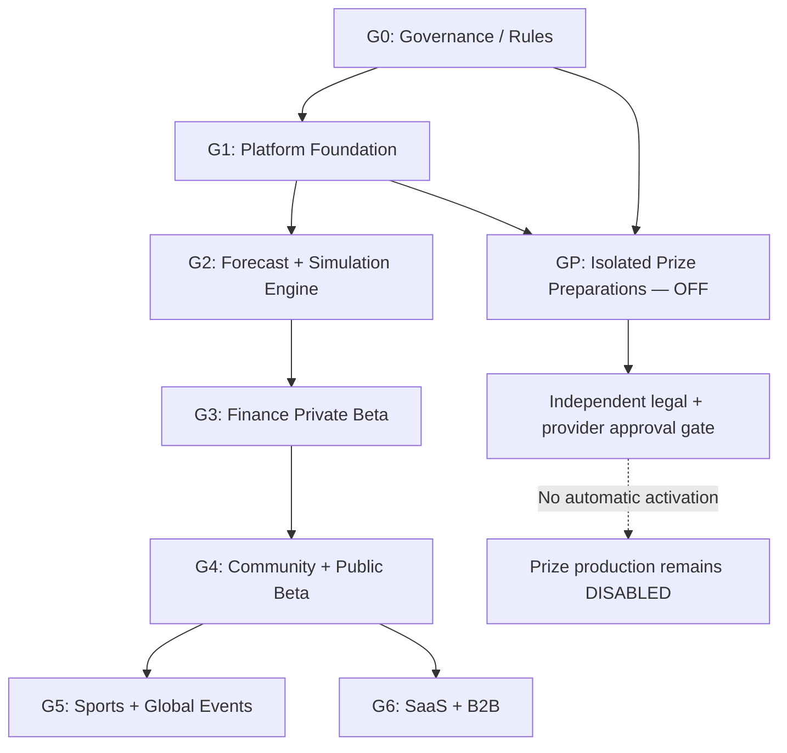

# FigSuite™ — GitHub Roadmap v1.1

**Version:** 2026-11-03 | **Status:** Proposal for founder approval | **Issues planned:** 60

**Repository:** `ByMarkAllan/FigSuite` confirmed 2026-11-04. The repository is not yet authorized for GitHub App writes; no roadmap Issues or Project board have been created.

## Execution contract

- Founder signs off on the v1.1 roadmap and individual new GitHub issue creation before publication.
- Each issue follows `Backlog → Ready → In progress → In review → Verification → Done`.
- Verification is an explicit approval stage, not an automatic transition from CI green.
- Branch from approved baseline, implement in a PR, run required checks, deploy staging for UAT, then request verification acceptance. Production release requires separate approval.
- Use GitHub Project fields: **Status**, **Priority**, **Gate/Milestone**, **Size**, **Vertical**, **Risk**, **Owner**, **Dependencies**, **Verification**.
- Labels: `area:g0` through `area:g6`, `area:gp`, `priority:p0/p1/p2`, `implementation`, `prize-disabled`, `compliance-gate`.
- Prize-control issues are **mock and disabled implementation only**. They are tracked in a separate cross-cutting GP swimlane and must never be treated as activation authorization.

## Dependency graph

## Release gate success criteria

| Gate | Outcome | Do not advance unless |
|---|---|---|
| G0 | Approved product rules | Legal and licensing risk register documented; core decisions signed |
| G1 | Secure infrastructure | RLS, CI, secret isolation, telemetry, threat model pass |
| G2 | Verified engine | LMSR correctness, concurrency, lock, settlement and ledger checks pass |
| G3 | Closed Finance beta | External source license confirmed, full forecasting flow and operator UAT signed |
| G4 | Public no-prize beta | Community moderation, anti-abuse, privacy, help and accessibility checklist signed |
| G5 | Multi-vertical beta | Independently verified sport and event oracle adapters |
| G6 | Commercial modules | Processor approval and premium fair-access separation validated |
| GP | Disabled prize interface only | Negative zero-egress tests and separate approval evidence; does not trigger release |

## Milestones and issue definitions

### G0 — Foundation / Governance
Decisions and legal/rights validation. **7 issues**.

| Issue | Priority | Size | Dependencies | Acceptance checkpoint |
|---|:---:|---:|---|---|
| [FGS-001] Confirm product charter and FigSuite v1.1 decision records | P0 | 3 | — | Founder signs Finance-first beta, domain glossary, no paid competitive advantage, and stage approvals |
| [FGS-002] Commission regulatory classification and contest-counsel matrix | P0 | 5 | FGS-001 | Written review maps CFTC, SEC, state gaming, sweepstakes, age, jurisdiction and tax considerations; prize remains disabled |
| [FGS-003] Validate payments and payout provider suitability | P0 | 3 | FGS-002 | Written SaaS payments scope and separate prize provider requirements documented; Stripe not presumed approved |
| [FGS-004] Verify source licenses and redistribution rights | P0 | 5 | FGS-001 | Named finance data sources have allowed uses, streaming rights, retention rules and cost assumptions documented |
| [FGS-005] Approve skill-score and reputation specification | P0 | 5 | FGS-001 | Brier baseline methodology, event cap, uncertainty and qualified-rank policies published with test vectors |
| [FGS-006] Approve event-resolution rulebook and dispute standards | P0 | 5 | FGS-001 | Tie, void, data correction, downtime, source dispute, timezone and appeals rules have examples and operator signoff |
| [FGS-007] Define hard-disabled prize safety contract | P0 | 3 | FGS-002, FGS-003 | Default DENY, no payment-to-prize link, no production credentials, approval evidence and fail-closed tests documented |

### G1 — Core Platform
Infrastructure, security and design shell. **9 issues**.

| Issue | Priority | Size | Dependencies | Acceptance checkpoint |
|---|:---:|---:|---|---|
| [FGS-008] Bootstrap typed pnpm monorepo and repo policy | P0 | 3 | FGS-001 | Apps packages workers and docs build; branch protection and CODEOWNERS recommended |
| [FGS-009] Configure CI quality and security checks | P0 | 5 | FGS-008 | Lint typecheck tests dependency scan secret scan run on PR and block merge on failure |
| [FGS-010] Provision isolated local preview staging production environments | P0 | 5 | FGS-008 | Separate databases secrets deployments and sanitized preview data; prod migration approval controls |
| [FGS-011] Implement Supabase authentication and verified profiles | P0 | 5 | FGS-010 | Email verification auth refresh logout age attestation and disabled account tests pass |
| [FGS-012] Implement RBAC RLS policies and permission test suite | P0 | 8 | FGS-011 | Anonymous and cross-user mutation denied; elevated roles require MFA; table grants audited |
| [FGS-013] Create audit event model and append-only operator log | P0 | 5 | FGS-010, FGS-012 | Every rule version admin decision and sensitive state change stores actor hashes and trace IDs |
| [FGS-014] Build FigSuite design tokens and terminal shell | P1 | 5 | FGS-008 | Accessible responsive shell with dark/light themes and core Combines Portfolio Rankings navigation |
| [FGS-015] Threat-model simulation feed identity and prize boundaries | P0 | 5 | FGS-007, FGS-012 | Threat register includes sybil feed tampering stale quote privilege escalation and prize pivot test plan |
| [FGS-016] Implement observability and incident telemetry baseline | P0 | 5 | FGS-009, FGS-010 | Trace IDs structured logs audit dashboards alerts and redaction verified in staging |

### G2 — Simulation Engine
Forecast, LMSR, events, resolution, scoring. **12 issues**.

| Issue | Priority | Size | Dependencies | Acceptance checkpoint |
|---|:---:|---:|---|---|
| [FGS-017] Migrate event catalog options and immutable event versions | P0 | 8 | FGS-012, FGS-006 | Schema constraints and immutable publication versions tested; invalid event cannot open |
| [FGS-018] Build finance observation ingest and source provenance | P0 | 8 | FGS-004, FGS-017 | Licensed feed adapter saves timestamps hashes gap markers and retry deduplication |
| [FGS-019] Implement exchange calendars and scheduled event transitions | P0 | 5 | FGS-017 | New York DST holidays half days and missed-trigger recovery pass deterministic tests |
| [FGS-020] Implement official forecast commit and revision workflow | P0 | 8 | FGS-017, FGS-012 | One current forecast per user/event; exact lock rejects and revisions audit; probabilities sum to one |
| [FGS-021] Implement stable LMSR market math and quote vectors | P0 | 8 | FGS-017, FGS-005 | K-outcome price sums to one; delta-cost and monotonicity property tests; stable overflow handling |
| [FGS-022] Implement atomic simulated wallet and allocation ledger | P0 | 8 | FGS-021, FGS-012 | Postgres row locks no overspend unique idempotency receipts and state-version advancement |
| [FGS-023] Build transactional outbox and internal streaming gateway | P1 | 8 | FGS-022, FGS-016 | Outbox at least-once delivery with subscriber dedupe and last-version resync |
| [FGS-024] Implement event lifecycle state machine and lock worker | P0 | 5 | FGS-017, FGS-019, FGS-013 | Illegal transitions rejected; scheduler restarts do not skip lock; audited state record |
| [FGS-025] Implement source-backed provisional resolution and correction | P0 | 8 | FGS-018, FGS-024, FGS-006 | Source evidence persisted; dispute state blocks finalization; corrections create new version |
| [FGS-026] Implement Brier scoring Bips ledger and rolling skill rating | P0 | 8 | FGS-020, FGS-025, FGS-005 | Replays deterministic; no duplicated Bips; baseline version recorded; confidence qualification |
| [FGS-027] Add end-to-end idempotency and transaction replay protection | P0 | 5 | FGS-022, FGS-025, FGS-026 | Concurrent requests and retries produce exactly one accepted effect per logical operation |
| [FGS-028] Execute math security and concurrency engine verification gate | P0 | 8 | FGS-021, FGS-022, FGS-025, FGS-026, FGS-027 | Signed G2 report covers property fuzz RLS load negative cases and prize zero-egress assertions |

### G3 — Finance Private Beta
Terminal, operator UX and closed test. **8 issues**.

| Issue | Priority | Size | Dependencies | Acceptance checkpoint |
|---|:---:|---:|---|---|
| [FGS-029] Build event discovery and filtering UX | P0 | 5 | FGS-014, FGS-017 | Filters event types status close time with clear feed staleness and accessible cards |
| [FGS-030] Build event detail resolution evidence and quote UI | P0 | 8 | FGS-029, FGS-023 | Source provenance locking timer simulator quote labels and latest receipt accurately displayed |
| [FGS-031] Build official probability forecast composer | P0 | 8 | FGS-020, FGS-030 | Probability simplex control confirms saved values server time and lock; editable only before lock |
| [FGS-032] Build simulation order preview and allocation flow | P0 | 8 | FGS-022, FGS-030 | Preview nonbinding; allocation receipt matches authoritative state; overspend rejection explained |
| [FGS-033] Build analyst portfolio and calibration dashboard | P0 | 8 | FGS-026, FGS-014 | Per-event history Brier scores baselines Bips adjustments and rolling rating visible |
| [FGS-034] Build qualified analyst and Bips leaderboards | P0 | 5 | FGS-026, FGS-033 | Min event count provisional markers confidence and anti-volume sorting verified |
| [FGS-035] Build restricted market operator and resolution console | P0 | 8 | FGS-024, FGS-025, FGS-013 | Role isolation four-eyes overrides immutable audit and event-source evidence UAT |
| [FGS-036] Run Finance private beta and readiness review | P0 | 8 | FGS-028, FGS-029, FGS-030, FGS-031, FGS-032, FGS-033, FGS-034, FGS-035 | G3 signoff includes licensed data staging checks tester feedback and no prize routing |

### G4 — Community & Public Beta
Guilds, chat, safety, launch readiness. **7 issues**.

| Issue | Priority | Size | Dependencies | Acceptance checkpoint |
|---|:---:|---:|---|---|
| [FGS-037] Implement Guilds membership invite and roster history | P1 | 8 | FGS-011, FGS-034 | Guild roles membership consent historical snapshots no asset transfers or pooled accounts |
| [FGS-038] Build Elite and Liquidity Guild ledgers | P1 | 8 | FGS-037, FGS-026 | Elite averages qualified skill with uncertainty; Liquidity sums lifetime Bips; sizes disclosed |
| [FGS-039] Implement per-option chat Session Gas and permissions | P1 | 8 | FGS-030, FGS-012 | Reading free; 10 gas writes/likes/mentions; caps self-vote block and expiry |
| [FGS-040] Implement content safety casework and moderation auditing | P0 | 8 | FGS-039, FGS-013 | Report review hide suspend appeal actions preserve history and permissions |
| [FGS-041] Implement risk-based anti-sybil and abuse monitoring | P0 | 8 | FGS-039, FGS-040, FGS-015 | Rate limits Turnstile device signals minimum data retention false-positive appeals |
| [FGS-042] Complete accessibility privacy and public beta trust checklist | P0 | 5 | FGS-036, FGS-040, FGS-041 | WCAG core flow audit export/delete controls disclosures incidents and support queues signed |
| [FGS-043] Launch public simulation beta behind release gate | P0 | 5 | FGS-042, FGS-036 | Founder approves only after trust security score and source license gates; prizes remain OFF |

### G5 — Cross-Vertical Expansion
Sports, Global Events and integrations. **4 issues**.

| Issue | Priority | Size | Dependencies | Acceptance checkpoint |
|---|:---:|---:|---|---|
| [FGS-044] Build sports adapter and result-resolution fixtures | P1 | 8 | FGS-028, FGS-006 | Postponement overtime abandoned events kickoff lock and correction scenarios pass |
| [FGS-045] Build global events adapter and official-source fixtures | P1 | 8 | FGS-028, FGS-006 | Official announcements dated revisions ambiguity appeal and long deadlines pass |
| [FGS-046] Add approved Composer strategy import and provenance | P2 | 8 | FGS-004, FGS-043 | Consent licensing strategy snapshot and data mapping pass; no real execution or account authority |
| [FGS-047] Provide research exports and multi-vertical segmentation | P1 | 5 | FGS-044, FGS-045, FGS-033 | CSV/JSON exports timezone and vertical ratings documented no leakage of private user forecasts |

### G6 — Commercial & Enterprise
Approved subscriptions and B2B analytics. **4 issues**.

| Issue | Priority | Size | Dependencies | Acceptance checkpoint |
|---|:---:|---:|---|---|
| [FGS-048] Define approved SaaS tiers and entitlement boundaries | P2 | 5 | FGS-003, FGS-043 | Entitlements analytics only; paid tier does not affect forecast chances grades prize odds |
| [FGS-049] Build approved subscription and workspace credit billing | P2 | 8 | FGS-048 | Provider written approval verified webhook idempotent reversals receipts and no simulation spend link |
| [FGS-050] Build sponsor disclosures and enterprise reporting | P2 | 8 | FGS-043, FGS-047 | Sponsor branding auditable opt-in aggregate reporting and conflict disclosures meet policy |
| [FGS-051] Prototype opt-in talent index and recruiter access controls | P2 | 8 | FGS-047, FGS-050 | Opt-in privacy research quality rubric and bias review completed before customer access |

### GP — Prize Isolation — NO ACTIVATION
Preparation and negative testing only; separate legal gate. **9 issues**.

| Issue | Priority | Size | Dependencies | Acceptance checkpoint |
|---|:---:|---:|---|---|
| [FGS-052] Create isolated prize schemas and data contracts only | P0 | 5 | FGS-007, FGS-012 | Separate store and service contracts with no simulator foreign-key payout derivation |
| [FGS-053] Implement network and credentials isolation for prize service | P0 | 8 | FGS-052, FGS-015 | No production credentials route endpoints or egress; failed attempts generate alerts |
| [FGS-054] Draft separate official contest rules and eligibility review model | P0 | 8 | FGS-002, FGS-007 | Counsel-required jurisdiction rule version age NPN and equal-odds review fields only; not launched |
| [FGS-055] Document payout-provider tax and identity requirements | P1 | 5 | FGS-003, FGS-054 | Signed provider review and tax/KYC reporting matrix required; no live credential installed |
| [FGS-056] Create approval-record and separation-of-duties control plane | P0 | 8 | FGS-052, FGS-054 | Dual approval evidence owner reviewer expires hashed rules program allowlist immutable |
| [FGS-057] Build mock-only prize obligation and webhook simulator | P1 | 8 | FGS-052, FGS-053 | Synthetic data mock provider signed event replay and reconciliation; no external transfers |
| [FGS-058] Add fail-closed prize flags and negative integration tests | P0 | 8 | FGS-053, FGS-056, FGS-057 | Misset flag forged signature unavailable approver all yield zero provider traffic and audit event |
| [FGS-059] Add financial reconciliation and exception runbook on mock data | P1 | 5 | FGS-055, FGS-057, FGS-058 | No double mock transfer reconciliation tolerance dead-letter and manual hold tests pass |
| [FGS-060] Establish independent prize production activation decision gate | P0 | 5 | FGS-002, FGS-003, FGS-054, FGS-055, FGS-056, FGS-058, FGS-059 | No activation until written counsel processor payout executive security finance signoffs and scoped authorization |

## Critical path

Foundation approval → event rulebook and data licensing → auth/RLS + event-version schema → forecast commit and LMSR transaction correctness → authoritative resolution → Brier/Bips scoring → finance user experience → G2 verification → private beta → community and public-beta safety verification.

The prize workstream **does not lie on the critical path**. Legal clearance cannot be inferred from technical completion, and a paid conversion funnel must not grant advantage to official scoring or future prize entries.

## GitHub Projects configuration

Recommended views: **Roadmap by Gate** (board), **Current Sprint** (iteration), **Blocking Dependencies** (table), **Compliance Hold** (filter `area:gp`), **Verification Queue** (Status=Verification), **Release Readiness** (group by Milestone).

Suggested Project fields: `Status` (Backlog, Ready, In progress, In review, Verification, Done, Blocked), `Priority` (P0/P1/P2), `Size` (1/2/3/5/8), `Gate` (G0-G6, GP), `Release` (Private Beta, Public Beta, Expansion, Research), `Risk` (Low/Medium/High/Critical), `Owner`, `Verification Owner`, `Approved For Implementation` (boolean).

### Issue creation procedure

1. Founder approves repo name, roadmap scope, and creation of the proposed issues.
2. Use the existing `ByMarkAllan/FigSuite` repository, protect the default branch, and attach GitHub Projects after authorizing the integration.
3. Commit `docs/`, `github/` and `diagrams/` files. Import the CSV as a planning data source; it is **not automatically a native GitHub Issue import**.
4. Optionally use `scripts/import_github_issues.py --repo ByMarkAllan/FigSuite --dry-run` to preview issue creation, then rerun with `--apply` **only after explicit authorization**. This script creates Issues and labels; Project field mappings are a separate operation.
5. Manually or via the GitHub Projects API, set dependencies, milestone groups, status and review owners. Do not automate release approval from status alone.

### Definition of ready

- Acceptance criteria and implementation boundary agreed; dependencies resolved or explicitly mocked.
- Migration and access impact known; no unapproved data/provider dependency.
- Risk and verification owner assigned; founder has approved issue creation/implementation according to project policy.

### Definition of done

- PR reviewed, security and correctness tests pass, staging UAT evidenced, migrations checked, docs/runbooks updated.
- Verification accepted by authorized approver; production release (if any) has a separate authorization.
- For any GP issue, test output must explicitly assert that payout execution is **disabled** and provider-call count is zero.

## Source artifacts

- Detailed issue rows and exact acceptance criteria: `github/FigSuite-v1.1-Issue-Backlog.csv` (UTF-8 with BOM for Excel convenience).
- Dry-run-first issue publisher: `scripts/import_github_issues.py`.
- Architecture diagram: `diagrams/FigSuite-System.mmd`.
- Canonical product and technical descriptions: `docs/01-PRD-v1.1.md`, `docs/02-TECHNICAL-ARCHITECTURE-v1.1.md`.
